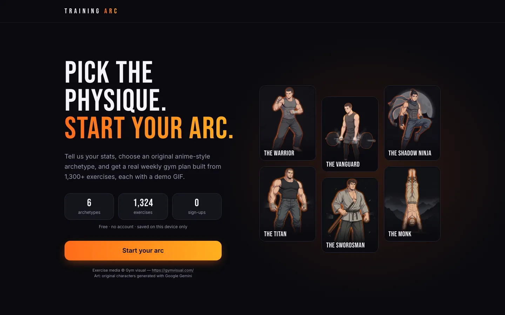
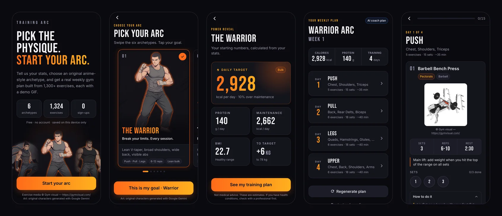
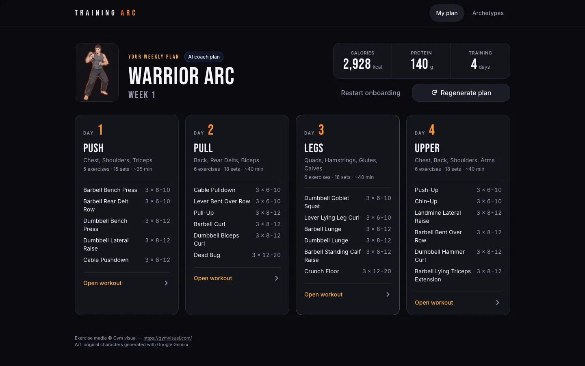
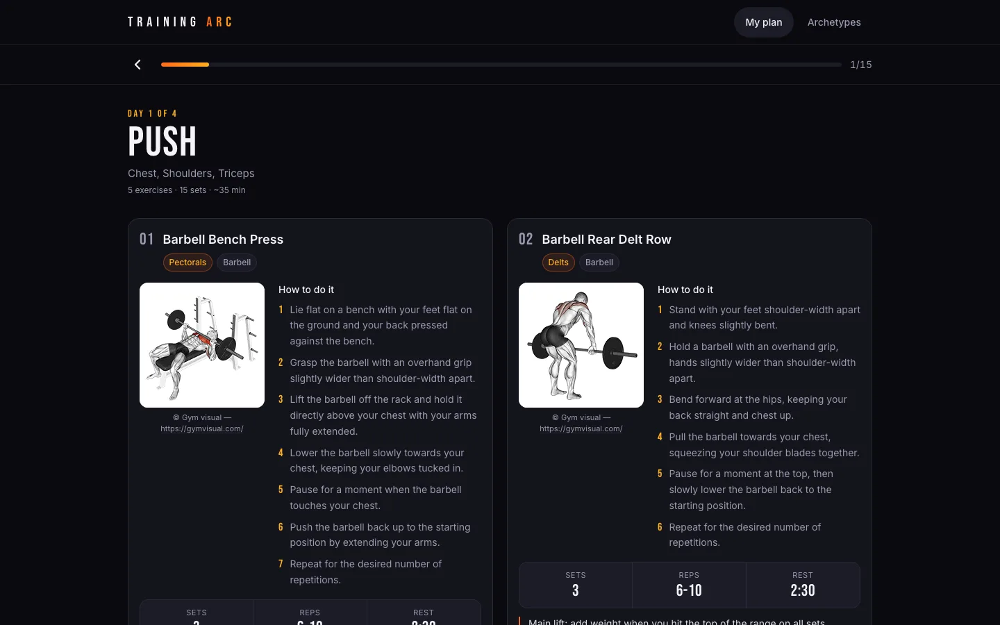
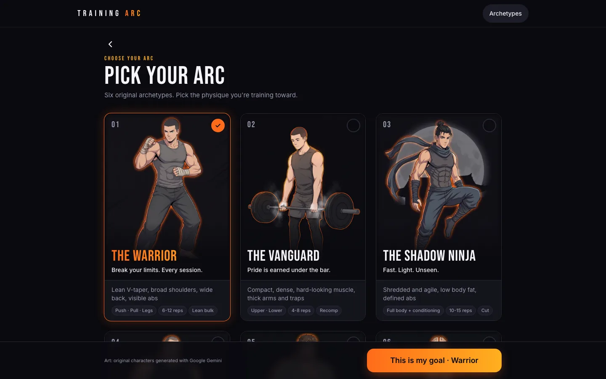
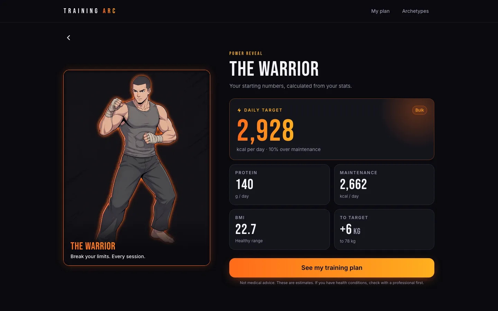
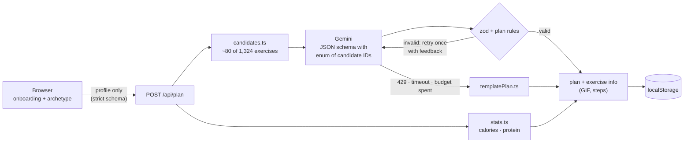

<div align="center">

# Training Arc

**Pick an original anime-style physique. Get a real weekly gym plan in seconds.**

Gemini writes the plan, but it can only choose from 1,324 real exercises, and all the nutrition maths is done in code.

[**Live demo →**](https://training-arc-nu.vercel.app)

[](https://nextjs.org)
[](https://react.dev)
[](https://www.typescriptlang.org)
[](https://tailwindcss.com)
[](https://ai.google.dev)
[](https://playwright.dev)
[](https://training-arc-nu.vercel.app)



</div>

---

## What it does

1. **Answer 10 quick questions:** height, weight, goal weight, body shape, experience, training days and equipment. One question per screen.
2. **Pick your arc:** choose one of six original anime-style archetypes (the Warrior, the Vanguard, the Shadow Ninja, the Titan, the Swordsman, the Monk). Each has its own training style and rep ranges.
3. **See your numbers:** a daily calorie target, protein, maintenance calories and BMI, calculated from your stats.
4. **Get your week:** a personalised plan for 2–6 days built by Gemini. Every exercise comes with a demo GIF and step-by-step instructions.
5. **Train:** tick off sets as you go. Your plan and progress are saved on your device, with no account needed.



<table>
  <tr>
    <td width="50%"></td>
    <td width="50%"></td>
  </tr>
  <tr>
    <td></td>
    <td></td>
  </tr>
</table>

The app is designed for phones first (375 px) and has its own layouts for desktop screens (1024 px and up).

---

## Engineering highlights

### 1. The AI can't make up exercises

Ask an LLM for a workout and it will happily invent a plausible-sounding "Incline Hammer Grip Flye" with a made-up ID and a broken GIF. Three layers prevent that:

| Layer | What it does |
|---|---|
| **Candidate pre-filter** | [`candidates.ts`](src/lib/candidates.ts) scores all 1,324 exercises by equipment, archetype, experience and staple lifts, and sends Gemini only **68–87 candidates** per profile. |
| **Constrained decoding** | The response uses a JSON schema where `exerciseId` is an **`enum` of the candidate IDs**, so the model *cannot* output any other ID. |
| **Validation, retry and fallback** | [`planSchema.ts`](src/lib/planSchema.ts) checks the shape with zod, and plan rules check day count, 4–7 exercises per day, and a balanced week (chest, back, legs and core; every full-body day mixes upper and lower body). If a plan fails, Gemini gets one retry with the errors as feedback. If that fails too, a hand-built [template plan](src/lib/templatePlan.ts) is used. |

Before building any UI, I tested this against **10 varied profiles** (every archetype, gym and home, 2–6 days, cut, bulk and recomp):

| Valid plans | Valid on the first try | Invented IDs | Median latency | Template fallbacks |
|:---:|:---:|:---:|:---:|:---:|
| **10 / 10** | 10 / 10 | **0** | **3.7 s** | 0 |

In production, a live end-to-end test (browser → Vercel → Gemini) returns a plan in about **3–4.5 s**.

### 2. The AI never does the maths

Calories and protein come from deterministic code in [`stats.ts`](src/lib/stats.ts), never from the model:

- BMR from **Mifflin-St Jeor**, and TDEE from an activity factor based on training days.
- **Safety limits:** calories never go below BMR, a cut never goes below 80% of TDEE, and a bulk never goes above 110%.
- Protein is 1.8 g per kg of *target* body weight.
- Body type only nudges reps and cardio; it never changes calories.

### 3. The user never sees an error screen

The Gemini free tier times out and rate-limits (HTTP 429), so the app is built to handle both:

- **Time budget:** 9 s for the first attempt, 15 s in total. After that the user gets the template plan (`source: "template"`), never an endless spinner.
- **SDK retries off:** the SDK's default of retrying a 429 five times is disabled, so a busy API doesn't eat the whole time budget.
- **Per-IP limit on the API route:** 5 AI plans per IP every 10 minutes. After that you get the template plan, not an error.
- **Size limit:** request bodies over 4 KB are rejected with a 413.
- **Network failures in the browser** show a Retry button.

### 4. Private by design

- **No accounts or database:** everything lives in `localStorage`. Every read is validated with zod, and missing or corrupt data sends the user back to onboarding instead of crashing.
- **Only plan inputs reach Gemini:** the API uses a strict profile schema, so names, emails or any other free text are rejected with a 400.
- **The API key stays on the server:** `GEMINI_API_KEY` is only imported from server-only modules, and the deploy checklist includes scanning the browser bundle to confirm the key isn't in it.

### 5. Original art pipeline

The six archetypes are **original characters**. No franchise characters, names or look-alikes appear in the code, copy, alt text or image prompts.

- **IP review:** each image was generated with Google Gemini, then checked against a written list of existing anime characters it must not resemble (see [`docs/ART_BRIEFS.md`](docs/ART_BRIEFS.md)).
- **Conversion:** [`scripts/convert-art.mjs`](scripts/convert-art.mjs) (sharp) detects and crops watermarks, fits each image to 3:4 at 768×1024 and exports WebP at **38–57 KB**.
- **No broken images:** a manifest only renders images that exist, and an SVG silhouette is the fallback if one fails to load.

### 6. Tested like a product

The [Playwright](https://playwright.dev) suite runs against a production build, with the Gemini API mocked:

- **Phone (375 px):** the full journey through all 10 onboarding questions, including back/forward, reload and the under-18 check.
- **Every exercise GIF** in the plan is checked to load with no 404s, and shown no larger than 180×180.
- **Persistence:** the browser is closed and reopened, and the plan and ticked sets must still be there.
- **Desktop (1440 and 1024 px) and tablet (768 px):** layouts are checked by measuring positions: columns side by side, no sideways scrolling, no cut-off text.
- **Accessibility:** every screen is checked for tap targets of at least 44 px and no sideways scrolling.
- **Failure cases:** corrupt storage, an image that fails to load, and a network drop on the reveal screen.

A separate `npm run test:live` calls the real Gemini API through the deployed site.

---

## Architecture



The dataset (1,324 exercises) is downloaded from a **pinned commit** at build time and slimmed to 0.9 MB by [`scripts/slim-dataset.mjs`](scripts/slim-dataset.mjs). GIFs load straight from that pinned GitHub commit; none are copied into the app.

---

## Tech stack

| Area | Tools |
|---|---|
| Framework | Next.js 16 (App Router, Turbopack), React 19, TypeScript |
| Styling and motion | Tailwind CSS 4 (design tokens in one `@theme`), Framer Motion, `next/font` (Inter, Bebas Neue) |
| AI | Google Gemini via `@google/genai`: structured output with a JSON schema, minimal thinking |
| Validation | zod 4 (API input, model output, `localStorage`) |
| Testing | Playwright (phone, tablet and desktop suites, plus a live AI test) |
| Tooling | sharp (image pipeline), tsx, ESLint |
| Hosting | Vercel |

---

## Getting started

Requires **Node.js 20.9+**.

```bash
git clone https://github.com/owaistaha/training-arc.git
cd training-arc
npm install
cp .env.example .env.local   # then add your Gemini API key
npm run dev                  # http://localhost:3000
```

Get a free API key at [Google AI Studio](https://aistudio.google.com/apikey). **The app also runs without one:** every plan is then a hand-built template plan.

| Variable | Required | Description |
|---|---|---|
| `GEMINI_API_KEY` | For AI plans | Server-only. Never prefix it with `NEXT_PUBLIC_`. |
| `GEMINI_MODEL` | No | Defaults to `gemini-3.5-flash-lite`. |

### Scripts

| Command | What it does |
|---|---|
| `npm run dev` / `build` / `start` | Develop, build and serve (the dataset is downloaded and slimmed automatically) |
| `npm run lint` | ESLint |
| `npm run test:e2e` | Playwright suite (phone, tablet, desktop) with the plan API mocked. Run `npx playwright install chromium` once first. |
| `npm run test:live` | One real Gemini plan end-to-end (uses API quota) |
| `npm run probe` | Reliability test: 10 varied profiles against Gemini, reporting validity, invented IDs and latency |
| `npm run art` | Convert source art in `art-raw/` to WebP |
| `npm run readme:shots` | Rebuild the README screenshots from the latest e2e run |

To test a deployed site, set `PLAYWRIGHT_BASE_URL=https://your-url npm run test:e2e`.

---

## Project structure

```
src/
  app/
    page.tsx                 landing
    onboarding/              10-step question flow (?step=N)
    arc/                     archetype picker
    reveal/                  calorie & protein reveal (plan builds in the background)
    plan/ · plan/[day]/      weekly plan · workout day with set tracking
    api/plan/route.ts        validation, rate limit, Gemini or template
  lib/
    stats.ts                 BMR, TDEE, calories, protein (deterministic)
    candidates.ts            exercise pre-filter per profile
    gemini.ts                request, JSON schema, time budget, retry
    buildPlan.ts             AI plan → template fallback
    planSchema.ts            zod schemas + plan rules
    templatePlan.ts          hand-built fallback plans
  components/                StepShell, ArchetypeCard, ExerciseCard, SetTicker, …
  data/archetypes.json       the six original archetypes
scripts/                     dataset slimming, probe, art conversion, README shots
tests/                       Playwright: e2e (mocked) + live
docs/                        PRD, tech spec, art briefs, deploy guide
```

**Planning docs:** [Product requirements](docs/PRD.md) · [Tech spec](docs/TECH_SPEC.md) · [Art briefs and IP checklist](docs/ART_BRIEFS.md) · [Deploy guide](docs/DEPLOY.md). [`CLAUDE.md`](CLAUDE.md) holds the project rules followed by the AI coding agent used during development.

---

## Credits

- **Exercise data:** [hasaneyldrm/exercises-dataset](https://github.com/hasaneyldrm/exercises-dataset) (MIT, with separate media terms).
- **Exercise media:** © [Gym visual](https://gymvisual.com/), credited next to every GIF in the app.
- **Character art:** original characters generated with Google Gemini.
- **Fonts:** [Inter](https://rsms.me/inter/) and [Bebas Neue](https://fonts.google.com/specimen/Bebas+Neue).

> **Not medical advice.** Calorie and protein targets are estimates. If you have a health condition, check with a professional before starting.

---

<div align="center">

Built by **Owais Taha** · [GitHub @owaistaha](https://github.com/owaistaha)

</div>
